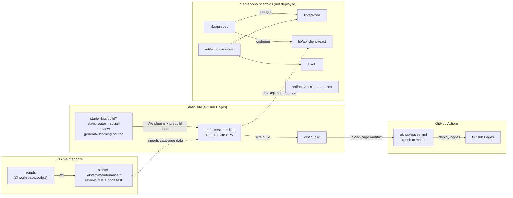

# Architecture — Programmable Banking Starter Kits ("Launchpad")

Launchpad is an independent community prototype, not an official Investec service. The product is a **fully static** React site published to GitHub Pages. Nothing in it calls a server, a database or a bank at runtime.

## 1. Overview

- **Tooling:** pnpm workspace (`pnpm-workspace.yaml`: `artifacts/*`, `lib/*`, `scripts`), TypeScript ~5.9 (`tsconfig.base.json`; root `tsconfig.json` holds project references to `lib/*`).
- **Toolchain pins:** Node 24.10 (`.nvmrc`, `engines.node: >=24.10 <25`), pnpm 10.26.1 (`packageManager`). A `preinstall` guard rejects npm and yarn.
- **Product stack:** React 19 + Vite 7 + Tailwind 4 + shadcn/Radix, `wouter` router (base-path aware).
- **Server-only scaffolds** (kept in the repo, not deployed): Express 5, PostgreSQL + Drizzle ORM, Zod + `drizzle-zod`, Orval codegen from OpenAPI.

## 2. Workspace packages

| Package | Path | What it does | Deployed to Pages |
|---|---|---|---|
| `@workspace/starter-kits` | `artifacts/starter-kits` | **The product.** Kit catalogue with in-browser demos, client-side ZIP/script downloads and `localStorage` checklist progress. Custom Vite plugins in `build/` emit static route entry pages, `404.html`, `.nojekyll` and OG/Twitter metadata. | **Yes** (`dist/public`) |
| `@workspace/scripts` | `scripts` | Maintainer CLIs and `node:test` suites (run via `tsx` against `artifacts/starter-kits/src/maintenance/`), CI adapter `ci-review-api.mjs`, `official-api-baseline.json`. | No |
| `@workspace/api-server` | `artifacts/api-server` | Express 5 scaffold with a single `GET /api/healthz` route, bundled with esbuild. `PORT` defaults to 3001. | No |
| `@workspace/mockup-sandbox` | `artifacts/mockup-sandbox` | Vite design-preview sandbox with a shadcn component gallery. `PORT`/`BASE_PATH` default to `5173` and `/`. | No |
| `@workspace/api-spec` | `lib/api-spec` | `openapi.yaml` (healthz only) and the Orval config that generates `lib/api-zod` and `lib/api-client-react`. | No |
| `@workspace/api-zod` | `lib/api-zod` | Generated Zod schemas. | No |
| `@workspace/api-client-react` | `lib/api-client-react` | Generated TanStack Query hooks. Declared as a starter-kits devDependency but not imported by the site. | No |
| `@workspace/db` | `lib/db` | Drizzle + `pg` scaffold with an empty schema. Requires `DATABASE_URL`. | No |

## 3. Dependency and deploy diagram



## 4. Runtime data flow

1. The browser loads `index.html` (or a pre-generated route entry such as `kits/<slug>/index.html`) under `BASE_PATH`.
2. `wouter` resolves routes from `import.meta.env.BASE_URL`. All kit data, fixtures and learning engines are bundled at build time.
3. Demos compute in the browser. Downloads are Blob URLs; the ZIP is written in-browser (`src/lib/starter-bundle.ts`).
4. Checklist progress is stored in `localStorage` under `launchpad.v1` (per origin).
5. No runtime network calls; no proxy, CORS or runtime env configuration is needed.

## 5. Build, test and run commands

Run from the repository root.

| Purpose | Command |
|---|---|
| Install everything | `pnpm install --frozen-lockfile` |
| Install site only | `pnpm install --frozen-lockfile --filter @workspace/starter-kits...` |
| Dev server (port 5173, base `/`) | `pnpm --filter @workspace/starter-kits dev` |
| Build site | `pnpm --filter @workspace/starter-kits build` |
| Preview built site | `pnpm --filter @workspace/starter-kits serve` |
| Typecheck workspace | `pnpm run typecheck` |
| Build workspace (typecheck + all packages) | `pnpm run build` |
| Social metadata tests | `pnpm --filter @workspace/starter-kits test:social` |
| Static hosting tests (needs `playwright install chromium`) | `pnpm --filter @workspace/starter-kits test:static` |
| Responsive tests / update baselines | `pnpm --filter @workspace/starter-kits test:responsive` · `test:responsive:update` |
| Learning-kit and API-mapping tests | `pnpm --filter @workspace/scripts test:learning-kits` · `test:mappings` |
| Source and API review tests (offline) | `pnpm test:sources` · `pnpm test:api-review` |
| Upstream source review (network, read-only) | `pnpm review:sources` — see [`scripts/SOURCE_REVIEW.md`](../scripts/SOURCE_REVIEW.md) |
| Official OpenAPI drift check (network, never approves baselines) | `pnpm review:api` — see [`scripts/API_ALIGNMENT.md`](../scripts/API_ALIGNMENT.md) |
| API server (port 3001) | `pnpm --filter @workspace/api-server dev` |
| Regenerate API hooks and Zod schemas | `pnpm --filter @workspace/api-spec run codegen` |
| DB push | `DATABASE_URL=… pnpm --filter @workspace/db push` |

Pages build example:

```sh
BASE_PATH=/investec-developer-starter-kits/ \
PUBLIC_SITE_URL=https://investec-developer-community.github.io/investec-developer-starter-kits/ \
  pnpm --filter @workspace/starter-kits build
# 1. node build/generate-learning-source.mjs --check   (downloaded engine == browser engine)
# 2. vite build (base = BASE_PATH)
#    staticRoutes()  → route entry pages, 404.html, .nojekyll
#    socialPreview() → absolute OG/Twitter image URLs from PUBLIC_SITE_URL
# → artifacts/starter-kits/dist/public
```

## 6. CI/CD workflows

| Workflow | Trigger | What it does |
|---|---|---|
| `ci.yml` | PRs, push to `main`, manual | Workspace typecheck; unit and maintenance tests (learning kits, mappings, source review, API review, CI adapter, social metadata); starter-kits build; responsive and keyboard Playwright tests. Manual runs can regenerate Ubuntu screenshot baselines. |
| `github-pages.yml` | Push to `main`, manual | Reads Pages config, installs site deps, runs `test:social`, builds with `BASE_PATH`/`PUBLIC_SITE_URL` from `configure-pages`, uploads `dist/public` and deploys to GitHub Pages. Pages write and OIDC permissions are limited to the deploy job. |
| `static-hosting.yml` | PRs | Learning-kit and social metadata checks, then `test:static` (static routes, root and sub-path base paths, no runtime network). |
| `official-api-review.yml` | Weekly (Mon 07:23 UTC), manual | Read-only comparison of official API contracts against the committed baseline; uploads review evidence. Never approves baselines. |

All workflows default to `contents: read` and check out with `persist-credentials: false`.

## 7. Static-site constraints

- **No network at runtime.** `tests/static/hosting.spec.ts` fails on any fetch/XHR or any request outside the hosting prefix.
- **Base path.** `vite.config.ts` validates `BASE_PATH` (absolute path, default `/`); every route and asset must resolve under it. `PORT` is read only in `serve` mode.
- **`404.html`.** Generated by the `staticRoutes()` build plugin so deep links work on GitHub Pages.
- **`.nojekyll`.** Emitted so GitHub Pages serves files and folders as-is.
- Only `artifacts/starter-kits/dist/public` is published. `attached_assets/` is committed for brand-asset provenance but is not a build input.

See [`artifacts/starter-kits/GITHUB_PAGES.md`](../artifacts/starter-kits/GITHUB_PAGES.md) for Pages setup details.

## 8. Known limitations

- Checklist progress is per origin and does not move between hosts.
- Responsive screenshot baselines are tied to the Ubuntu Chromium used in CI; regenerate them with the manual `ci.yml` run when rendering changes.
- `official-api-review.yml` stays red until maintainers approve official API baselines.
- `@workspace/api-client-react` is a declared but unused starter-kits devDependency.
- The server-only scaffolds (`api-server`, `mockup-sandbox`, `lib/*`) are not exercised by the site and have minimal functionality.
