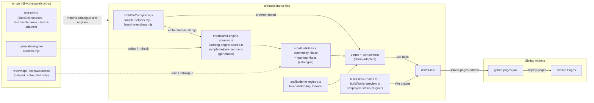

# Architecture — Launchpad — Programmable Banking Starter Kits

Launchpad is an independently maintained, mock-first inspiration and learning showcase built by the Investec Developer Community. It is not an official Investec service. The website is a **fully static, credential-free** React site published to GitHub Pages. It has no credential inputs or bundled credentials, and it makes no runtime calls to a server, database or bank. Browser demos and downloadable kits use fictional sample data to show patterns that follow the documented API and programmable-card mechanics.

Launchpad only **links** to the [official Investec sandbox](https://developer.investec.com/api-reference/SA%20PB%20Account%20Information#description/sandbox) and the [Community sandboxes](https://github.com/Investec-Developer-Community/Community-Projects#-sandboxes--local-development) (decision D-2). It never asks for their credentials or calls them. Sandbox or production integration is not a Launchpad capability.

## 1. Overview

- **Workspace:** pnpm workspace with two packages (`pnpm-workspace.yaml`: `artifacts/*`, `scripts`). The only artifact is `artifacts/starter-kits`. Each package has its own `tsconfig.json` that extends the root `tsconfig.base.json`; there is no root `tsconfig.json`.
- **Toolchain pins:** Node 24.10.0 (`.nvmrc`; `engines.node: >=24.10 <25`), pnpm 10.26.1 (`packageManager`), TypeScript ~7.0 (root devDependency). A `preinstall` guard rejects npm and yarn. `minimumReleaseAge: 1440` delays new package versions by one day.
- **Product stack:** React 19.3.1 (exact catalog pin), Vite 8, Tailwind 4, shadcn/Radix UI, and the base-path-aware `wouter` router.
- **Removed scaffolds:** the Express API server, the design-preview sandbox, the database package, and the OpenAPI spec with its generated Zod and React-client packages were deleted on 2026-11-06 after usage was verified (decision D-3). Git history keeps them.

## 2. Workspace packages

| Package | Path | What it does | Deployed to Pages |
|---|---|---|---|
| `@workspace/starter-kits` | `artifacts/starter-kits` | **The product.** Kit catalogue, in-browser demos, client-side ZIP and script downloads, and `localStorage` checklist progress. Build-time Vite plugins emit the status markup, static route entry pages, `404.html`, `.nojekyll` and OG/Twitter metadata. | **Yes** (`dist/public` only) |
| `@workspace/scripts` | `scripts` | The engine-source generator (`generate-engine-sources.mjs`), maintainer review CLIs (run through `tsx` against `artifacts/starter-kits/src/maintenance/`), the CI adapter `ci-review-api.mjs`, `official-api-baseline.json`, the shared test network guard `test-fetch-local-only.mjs`, and the offline test runner scripts. | No |

## 3. Dependency and deploy diagram



## 4. Catalogue, slugs and demo registry

- **Slugs.** `src/data/kit-slugs.ts` lists every catalogue slug as a `const` tuple and exports the `KitSlug` type. `Kit.slug` is typed as `KitSlug`.
- **Catalogue.** `src/data/kits.ts` defines kits 1–3 (Interest Maximiser, Spend Explorer, Card Guard) and assembles the full list from `community-kits.ts` (kits 4–6: Payment Pinger, Card-To-Sheet-Sync, Swipe 'n Save) and `learning-kits.ts` (kits 7–9: Cashflow Runway, Recurring Payment Detective, Who Paid). `getKit(slug)` looks up a kit.
- **Demo registry (FR-11 / P1-6).** `src/lib/demo-registry.ts` maps each slug to its demo component and is checked with `satisfies Record<KitSlug, ComponentType>`. A catalogue kit without a demo, or a demo for a slug that is not in the catalogue, is a **type error**. `src/maintenance/demo-mapping.test.ts` checks the same thing at test time. There is no fallback demo: `DemoFrame` renders only registered demos, and an unknown slug renders the kit not-found page.
- **Demo adapters.** `src/components/demos.tsx` (kits 1–3), `community-demos.tsx` (kits 4–6) and `learning-demos.tsx` (kits 7–9) are thin React adapters. They hold UI state and call the engines; they hold no domain logic.
- **Status wording.** `src/data/project-status.ts` is the single source of the approved status text (decision D-1). `src/components/project-status.tsx` renders it, and `src/project-status-plugin.ts` injects the same markup into `index.html` at build time. Tests import the constant rather than copying the text.

## 5. Engines, generated sources and fixtures

- **One sharing mechanism for kits 1–9.** Each kit's domain logic is a pure ES module in `src/data/` with a `.d.mts` type file: `interest-maximiser-engine.mjs`, `spend-explorer-engine.mjs`, `card-guard-engine.mjs`, `payment-pinger-engine.mjs`, `card-to-sheet-sync-engine.mjs`, `swipe-n-save-engine.mjs`, `learning-engines.mjs` (kits 7–9) and the shared `sample-helpers.mjs`. The browser demo imports the module directly. The download embeds the same source text, either inline in the kit script or as a separate file (`card-rules.mjs` for Card Guard; `sample-helpers.mjs` in kits that use documented API shapes). The demo and the downloaded script therefore run identical code.
- **Generated sources.** `scripts/generate-engine-sources.mjs` is the only generator. It writes `kit-engine-sources.ts` (kits 1–6), `learning-engine-source.ts` and `sample-helpers-source.ts`. Do not edit these files by hand. Regenerate with `pnpm --filter @workspace/scripts generate:kit-sources`. The starter-kits `build` runs the generator with `--check` and fails on stale output, and `src/maintenance/engine-sources.test.mjs` fails too.
- **Parity.** `src/maintenance/kit-engine-parity.test.ts` checks that the browser path and the downloaded script produce the same results.
- **Card Guard.** The download contains `card-guard.mjs`, `card-rules.mjs` (the engine), `card-guard-mock-data.json` (decision D-6) and the `simulate-card-code.mjs` teaching harness. Amounts use the en-ZA format, for example `R 1 500,00`, in both the browser and the download (decision D-7). `formatRand` builds this format by hand, so it does not depend on ICU data.
- **Fixtures.** All fixtures are fictional and follow documented response envelopes (for example `data.transactions`). Kits 1–6 keep their fixtures in the catalogue files. Kits 7–9 use `learning-fixtures.ts`. `api-mappings.ts` and `official-api.ts` record how fields map to the documented API. `source-review.ts` holds community attribution and review metadata.

## 6. Runtime data flow

1. The browser loads `index.html`, or a pre-generated route entry such as `kits/<slug>/index.html`, under `BASE_PATH`.
2. `wouter` resolves routes from `import.meta.env.BASE_URL`. Kit data, fixtures and engines are bundled at build time.
3. Demos compute in the browser through the engines.
4. **Downloads** are built in the browser. `src/lib/starter-bundle.ts` writes the ZIP, and `downloadText` in `src/lib/local.ts` creates single-file downloads. Both use Blob URLs; no request is made.
5. **Checklist progress** is stored in `localStorage` under `launchpad.v1` (per origin). `src/lib/local.ts` tolerates missing, malformed or corrupted values.
6. The website makes no runtime network calls, so it needs no proxy, CORS setup or runtime configuration.

Downloaded kits are separate local sample programs. They run offline on fictional data and are not live bank clients. Tests use fixtures or local fakes only and never call live services.

## 7. Build tooling

| Piece | Location | Role |
|---|---|---|
| Engine-source check | `scripts/generate-engine-sources.mjs --check` | First step of the starter-kits `build`. Fails if a generated source is stale. |
| Status plugin | `src/project-status-plugin.ts` | Replaces the single `<!-- PROJECT_STATUS -->` marker in `index.html` with the rendered status. Fails the build if the marker is missing or repeated. |
| Static routes | `build/static-routes.ts` | Writes route entry pages for every catalogue kit, `404.html` and `.nojekyll`. |
| Social preview | `build/social-preview.ts` | Writes absolute OG/Twitter image URLs from `PUBLIC_SITE_URL`. Without it, the build warns and keeps base-relative URLs. Tested by `test:social`. |
| Base path | `vite.config.ts` | Validates `BASE_PATH` (absolute, default `/`). `PORT` is read only by `dev` and `serve`. |
| Asset scripts | `build/generate-social-preview.sh`, `build/generate-zebra-assets.sh` | Maintainer scripts for committed brand images. Not part of the build. |

`build/generate-learning-source.mjs` is no longer referenced by any script; it was replaced by the single generator (see §12).

## 8. Maintenance tooling

| Command | Network | What it does |
|---|---|---|
| `pnpm --filter @workspace/scripts generate:kit-sources` | No | Regenerates the embedded engine sources. |
| `pnpm --filter @workspace/scripts check:kit-sources` | No | Fails if the generated sources are stale. |
| `pnpm review:api` | Yes (read-only, GET only) | Compares official OpenAPI contracts with `scripts/official-api-baseline.json`. Never approves baselines. See [`scripts/API_ALIGNMENT.md`](../scripts/API_ALIGNMENT.md). |
| `pnpm review:sources` | Yes (read-only) | Checks community source links, licences and review dates. Exit 1 means a human must review. See [`scripts/SOURCE_REVIEW.md`](../scripts/SOURCE_REVIEW.md). |
| `pnpm test:api-review` · `pnpm test:sources` | No | Offline tests for the two review tools. |

## 9. Tests by category

All offline Node suites run through `@workspace/scripts` `test:offline`: `check:kit-sources`, then `test:maintenance` (every `artifacts/starter-kits/src/maintenance/**/*.test.{ts,mjs}` file by glob, through `tsx`, with the `test-fetch-local-only.mjs` network guard preloaded), then `test:ci-adapter`. A new maintenance test is picked up without editing any script. `@workspace/starter-kits` `test:unit` is an alias for `test:offline`. The ZIP checks need `python3`.

| Category | Files | Runner |
|---|---|---|
| Architecture invariants (no browser) | `src/maintenance/architecture-invariants.test.ts` — no server, database or HTTP-client dependency; every kit fixture is fictional and every starter runs with the network blocked; the shared fetch guard really blocks | `test:unit` |
| Catalogue and registry | `demo-mapping.test.ts`, `library-query.test.ts`, `kits-mock-only.test.ts` | `test:unit` |
| Engines and downloads | `engine-sources.test.mjs`, `kit-engine-parity.test.ts`, `starter-bundle.test.ts`, `spend-explorer.test.ts`, `swipe-percentage.test.ts`, `card-code.test.mjs`, `learning-kits.test.ts` | `test:unit` |
| API alignment and guidance | `api-mappings.test.ts`, `official-api-note.test.ts`, `official-contract-review.test.ts`, `source-review.test.ts` | `test:unit` |
| Credential and copy safety | `credential-safety.test.mjs` (source, script and ZIP scans), `mock-first-copy.test.mjs` | `test:unit` |
| CI adapter | `scripts/ci-review-api.test.mjs` | `test:unit` |
| Social metadata | `build/social-preview.test.mjs`, `build/social-preview-build.test.mjs` | `test:social` |
| Static hosting (Playwright, built site at `/` and `/starter-kits/`, plain file server, no SPA fallback) | `tests/static/hosting.spec.ts`, `invariants.spec.ts`, `trust-contracts.spec.ts`, `learning-kits.spec.ts`, `branding.spec.ts`, `a11y-meta.spec.ts`; helper `site-meta.ts` reads metadata from `index.html` | `test:static` |
| Responsive, keyboard and accessibility (Playwright, 320, 390 and 1440 px) | `tests/responsive/launchpad.spec.ts` (screenshot baselines), `kit-containment.spec.ts` (every kit page, before and after operating its demo), `a11y.spec.ts` (axe WCAG 2.2 A/AA rule tags on every route plus two 404 routes, at 320, 390 and 1440 px, with and without reduced motion), `progress.spec.ts`, `library-url.spec.ts`, `quickstart.spec.ts`, `command-copy.spec.ts` | `test:responsive` |

The automated axe checks pass. They do not establish full WCAG conformance; manual screen-reader checks are tracked separately.

## 10. Architectural invariants

| # | Invariant | Enforced by |
|---|---|---|
| 1 | No credential input fields | `tests/static/invariants.spec.ts` (every route, both base paths, with a detector self-test); `tests/static/trust-contracts.spec.ts`; `src/maintenance/credential-safety.test.mjs` |
| 2 | No runtime fetch, XHR, WebSocket or off-origin request | `tests/static/invariants.spec.ts` (network guard on every route, plus a scan of the built bundle for network clients and banking API hosts) |
| 3 | No backend dependency | `src/maintenance/architecture-invariants.test.ts` (declared dependencies); `tests/static/invariants.spec.ts` (bundle scan for backend packages) |
| 4 | Works at `/` and `/<repo>/` | `playwright.static.config.ts` root and repository projects; every `tests/static/*.spec.ts` runs on both |
| 5 | Deep links and refresh work | `tests/static/hosting.spec.ts`; `tests/static/invariants.spec.ts` (query strings and hashes) |
| 6 | Unknown routes give a real 404 | `tests/static/invariants.spec.ts`; `tests/static/hosting.spec.ts`; `tests/responsive/a11y.spec.ts` (accessible not-found page) |
| 7 | Downloads are client-side | `tests/static/invariants.spec.ts` (every download is a Blob with no request); `src/maintenance/starter-bundle.test.ts` |
| 8 | Corrupted `localStorage` cannot break the app | `tests/static/invariants.spec.ts`; `tests/responsive/progress.spec.ts` |
| 9 | Fixtures are fictional mock data | `src/maintenance/architecture-invariants.test.ts`; `kits-mock-only.test.ts`; `credential-safety.test.mjs`; `mock-first-copy.test.mjs` |
| 10 | Tests never call live services | `scripts/test-fetch-local-only.mjs` preloaded by `test:maintenance` and `test:ci-adapter`; `src/maintenance/architecture-invariants.test.ts` (guard self-test and starters run with the network blocked); Playwright network guards |
| 11 | A missing demo fails loudly | `src/lib/demo-registry.ts` (`satisfies Record<KitSlug, …>`, caught by `pnpm run typecheck`); `src/maintenance/demo-mapping.test.ts` |
| 12 | Deploy is static and credential-free | `github-pages.yml` uploads only `artifacts/starter-kits/dist/public`; invariants 1, 2, 4 and 7 |

## 11. Commands

Run from the repository root.

| Purpose | Command |
|---|---|
| Install everything | `pnpm install --frozen-lockfile` |
| Install site only | `pnpm install --frozen-lockfile --filter @workspace/starter-kits...` |
| Dev server (port 5173, base `/`) | `pnpm --filter @workspace/starter-kits dev` |
| Build site | `pnpm --filter @workspace/starter-kits build` |
| Preview built site | `pnpm --filter @workspace/starter-kits serve` |
| Typecheck both packages | `pnpm run typecheck` |
| Typecheck then build | `pnpm run build` |
| Offline unit and maintenance tests | `pnpm --filter @workspace/starter-kits test:unit` |
| Social metadata tests (after a build) | `pnpm --filter @workspace/starter-kits test:social` |
| Static hosting tests (needs `playwright install chromium`) | `pnpm --filter @workspace/starter-kits test:static` |
| Responsive tests | `pnpm --filter @workspace/starter-kits test:responsive` |
| Regenerate engine sources | `pnpm --filter @workspace/scripts generate:kit-sources` |
| Upstream source review (network) | `pnpm review:sources` |
| Official OpenAPI drift check (network) | `pnpm review:api` |

Pages build example:

```sh
BASE_PATH=/investec-developer-starter-kits/ \
PUBLIC_SITE_URL=https://investec-developer-community.github.io/investec-developer-starter-kits/ \
  pnpm --filter @workspace/starter-kits build
# 1. node ../../scripts/generate-engine-sources.mjs --check   (embedded engines == browser engines, kits 1–9)
# 2. vite build (base = BASE_PATH)
#    projectStatusPlugin() → status markup in index.html
#    staticRoutes()        → route entry pages, 404.html, .nojekyll
#    socialPreview()       → absolute OG/Twitter image URLs from PUBLIC_SITE_URL
# → artifacts/starter-kits/dist/public
```

## 12. CI/CD

All jobs run on `ubuntu-24.04`, read Node from `.nvmrc` and pnpm from `packageManager`, install with `--frozen-lockfile`, default to `contents: read` and check out with `persist-credentials: false`.

**Pull request gates** (no network beyond package installation):

| Workflow · job | What it does |
|---|---|
| `ci.yml` · Workspace typecheck | `pnpm run typecheck` (catches a missing demo registration) |
| `ci.yml` · Unit and maintenance tests | `test:unit` and `test:social`. Runs on the runner because the ZIP checks need `python3`. |
| `ci.yml` · Starter-kits build | Builds at `/` and at a repository sub-path. Fails on stale engine sources. |
| `ci.yml` · Responsive and keyboard regressions | `test:responsive` in the `mcr.microsoft.com/playwright:v1.64.1-noble` container |
| `static-hosting.yml` | `test:static` in the same container |

`ci.yml` also runs on push to `main`. A manual run with `update_snapshots` regenerates the responsive baselines in the pinned container and uploads them as an artifact; they are never committed automatically. When `@playwright/test` changes in `pnpm-lock.yaml`, bump the container tag in both workflows and regenerate the baselines.

**Deploy:** `github-pages.yml` (push to `main`, manual) runs `test:social`, builds with `BASE_PATH` and `PUBLIC_SITE_URL` from `actions/configure-pages`, uploads only `artifacts/starter-kits/dist/public` and deploys it. Only the deploy job has Pages write and OIDC permissions.

**Scheduled network jobs** (never pull request gates; never approve anything):

| Workflow | Schedule | What it does |
|---|---|---|
| `official-api-review.yml` | Mondays 07:23 UTC, manual | Runs `test:api-review` and `test:ci-adapter` offline, then compares official contracts with the committed baseline. Uploads evidence for 30 days. |
| `source-review.yml` | 1st of each month 07:41 UTC, manual | Runs `test:sources` offline, then `review:sources --json`. Uploads the report for 30 days. |

## 13. Static-site constraints

- **Static and credential-free.** No credential inputs, no runtime requests, no backend (see §10).
- **Base path.** Every route and asset resolves under `BASE_PATH`.
- **`404.html` and `.nojekyll`** are generated so deep links work and GitHub Pages serves files as-is.
- Only `artifacts/starter-kits/dist/public` is published. `attached_assets/` is committed for brand-asset provenance but is not a build input.
- **Brand direction.** No Investec or Investec Developer logo; use a plain text link to <https://developer.investec.com/>. Site name: **Launchpad — Programmable Banking Starter Kits**. The approved attribution and status wording are in [`decisions/product-guardrails.md`](./decisions/product-guardrails.md).

See [`artifacts/starter-kits/GITHUB_PAGES.md`](../artifacts/starter-kits/GITHUB_PAGES.md) for Pages setup.

## 14. Known limitations

- Checklist progress is per origin and does not move between hosts.
- Responsive screenshot baselines are tied to the pinned Playwright container.
- `official-api-review.yml` reports missing approvals and contract drift until a human approves the baseline.
- Sample code illustrates documented mechanics with fictional data. Passing offline tests does not establish a live bank integration.
- `artifacts/starter-kits/build/generate-learning-source.mjs` is orphaned and awaits deletion. `scripts/src/hello.ts` (the `hello` script) is a leftover placeholder.
